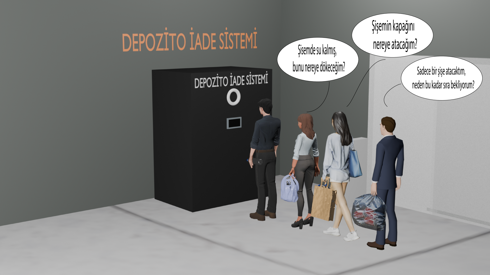

# Malta Makine — Depozito İade Sistemi

Plastik şişe, cam şişe ve teneke kutuları toplayan **depozito iade makineleri (RVM)** için uçtan uca yazılım: tanıtım web sitesi, makineleri uzaktan izleyen yönetim paneli, REST API, PostgreSQL veritabanı ve servis personeli için mobil uygulama.



## Bileşenler

| Klasör | Ne yapar? | Teknoloji |
|---|---|---|
| [`web-sitesi/`](web-sitesi) | Sistemi tanıtan tek sayfalık site: kabul edilen ürünler, 4 adımda iade süreci, hedef sektörler | HTML, CSS, JavaScript |
| [`yonetici-paneli/`](yonetici-paneli) | Makinelerin canlı durumunu izleyen ve yöneten web paneli | HTML, CSS, JavaScript |
| [`backend/`](backend) | Paneli besleyen REST API: kimlik doğrulama, yetkilendirme, makine ve arıza yönetimi | Node.js, Express, PostgreSQL, JWT |
| [`veritabani/`](veritabani) | Rol tabanlı yetkilendirmeli (RBAC) veritabanı şeması: 21 tablo | PostgreSQL |
| [`mobil-uygulama/`](mobil-uygulama) | Servis personelinin makineye bağlanıp kapakları açıp kapattığı uygulama (demo) | Flutter / Dart |

## Yönetim paneli özellikleri

- **Makine izleme:** doluluk oranları (plastik / teneke / cam / atık su), ezme üniteleri (0,5 L ve 1–3 L), cam kırma, atık su karıştırma ve pompa, fan, kamera, kapak motorları, ekran durumu, acil durum alarmı
- **Arıza yönetimi:** arıza bildirme, bildirilen arızaların takibi, servis talepleri
- **Kullanıcı ve firma yönetimi:** firma, mağaza ve makine tanımlama, kayıt onaylama, kullanıcıya özel yetki
- **Denetim:** giriş ve aktivite logları, bildirimler

## Backend mimarisi

- **Kimlik doğrulama:** JWT access + refresh token. Refresh token'lar hash'lenerek saklanır ve her yenilemede değiştirilir. 3 hatalı girişte hesap 15 dakika kilitlenir.
- **Rol tabanlı yetkilendirme (RBAC):** `roles`, `permissions`, `role_permissions` ve kullanıcıya özel istisnalar. Her istekte yetki kontrolü yapılır.
- **Veri kapsamı:** Her rol yalnızca kendi verisini görür.

  | Rol | Görebildiği |
  |---|---|
  | Süper Admin | Tüm sistem |
  | Firma | Kendi firmasının makineleri |
  | Market | Kendi marketindeki makineler |
  | Servis Personeli | Kendisine atanmış makineler |
  | Kamu Kurumu | Tüm makineler (salt okunur) |

- **Güvenlik:** `helmet`, `express-rate-limit`, CORS, bcrypt ile şifre hash'leme
- **Sürüm kontrollü şema:** 13 migration dosyası (`backend/src/migrations/`)
- **Otomatik kayıt:** Her yazma işlemi `activity_logs` tablosuna düşer. Arıza ve kritik doluluk durumlarında bildirim oluşur.

Ayrıntılı API ve kurulum bilgisi: [`backend/README.md`](backend/README.md)

## Kurulum (özet)

```bash
# 1. Veritabanı
createdb -U postgres machine_management_db

# 2. Backend
cd backend
npm install
cp .env.example .env      # veritabanı ve JWT ayarlarını düzenleyin
npm run migrate
npm run seed              # ilk Süper Admin kullanıcısını oluşturur
npm run dev               # http://localhost:4000

# 3. Yönetim paneli
# yonetici-paneli/ klasörünü bir statik sunucuyla açın (ör. VS Code Live Server, port 5500)
```

> `.env.example` ve örnek veri dosyalarındaki şifreler yalnızca yerel geliştirme içindir. Gerçek ortamda mutlaka değiştirin.

## Klasör yapısı

```
web-sitesi/          Tanıtım sitesi
yonetici-paneli/     Yönetim paneli sayfaları
  assets/css         Stil dosyaları
  assets/js          Sayfa scriptleri ve API istemcisi
  assets/veri-tabani Örnek verili veritabanı betiği
backend/
  src/routes         REST uç noktaları (auth, machines, faults, users ...)
  src/lib            JWT, yetki ara katmanı, kapsam filtresi, loglama
  src/migrations     Veritabanı migration'ları
  src/scripts        migrate / seed betikleri
veritabani/          PostgreSQL şeması
mobil-uygulama/      Flutter servis uygulaması (demo) + HTML prototipi
```
